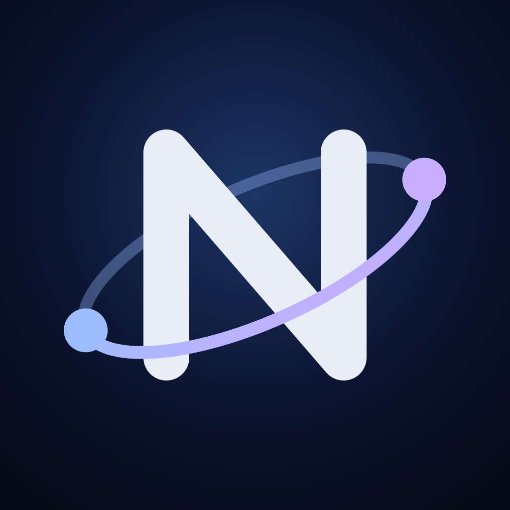
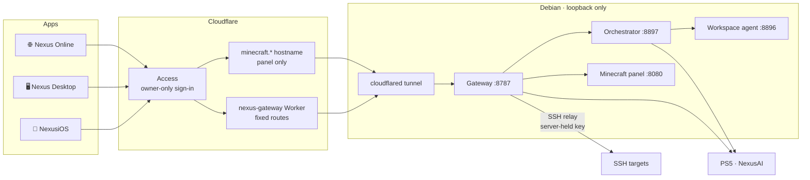

<div align="center">



# NexusBackend

**The owner-only backend behind every Nexus app.**<br>
An authenticated AI and SSH gateway, the Cloudflare Worker in front of it, an agent orchestrator and a read-only workspace bridge. Nothing listens publicly.

[](gateway)
[](cloudflare)
[](agent-orchestrator)
[](https://nexus.liamjc.dev/docs/backend/debian/)
[](https://github.com/ljcatherine/Nexus)

[**Setup guide**](https://nexus.liamjc.dev/docs/backend/debian/) ·
[Cloudflare](https://nexus.liamjc.dev/docs/backend/cloudflare/) ·
[Gateway reference](docs/GATEWAY.md) ·
[API](gateway/openapi.yaml) ·
[Restricted commands](docs/integrations/RESTRICTED-COMMANDS.md) ·
[Security](SECURITY.md)

</div>

---

## How it fits together



Every request passes three independent checks: **Cloudflare Access** signs you in, the
**Worker** confirms the Access audience and owner email, and the **gateway** verifies the
signed assertion again and applies per-subject permissions. The tunnel is outbound-only,
so the server opens no inbound ports.

## What's inside

| | Component | What it does |
|---|---|---|
| 🛡️ | [**`gateway/`**](gateway) | Go service on `127.0.0.1:8787`. OIDC-verified routes for AI chat, model control, search, encrypted conversation sync, the SSH relay and the Minecraft panel proxy. Ships systemd unit templates. |
| ☁️ | [**`cloudflare/`**](cloudflare) | The `nexus-gateway` Worker. Checks Access, then forwards an allowlist of routes and methods over Workers VPC. Serves the panel only on its own hostname. |
| 🧠 | [**`agent-orchestrator/`**](agent-orchestrator) | Python service that turns chats into durable agent runs, with human review for every patch and command. |
| 📂 | [**`workspace-agent/`**](workspace-agent) | Go read-only workspace bridge, one per host (Debian and NixOS). |
| 🤖 | [**`integrations/hermes/`**](integrations/hermes) | Optional Hermes engine worker used by the orchestrator. |
| 🧰 | [**`scripts/`**](scripts) | Local gateway runner, Debian hardening, nftables rules and their tests, Access client registration. |

## Quick start

> [!TIP]
> The full walkthrough, including Cloudflare Access, Workers VPC and the tunnel, is the
> [Debian backend guide](https://nexus.liamjc.dev/docs/backend/debian/).

**1. Configure the gateway.** Copy the template to an owner-only file outside the repo and fill in your own values:

```sh
install -d -m 700 ~/.config/nexus-gateway
cp gateway/.env.example ~/.config/nexus-gateway/nexus.env
chmod 600 ~/.config/nexus-gateway/nexus.env
```

**2. Build and test it.**

```sh
cd gateway
CGO_ENABLED=0 go test ./...
CGO_ENABLED=0 go build -trimpath -o nexus-gateway .
```

**3. Install the service.** Review the unit templates in [`gateway/`](gateway) for your host, then enable them with `systemctl --user` (or as system units).

**4. Deploy the Worker.**

```sh
cd cloudflare
cp wrangler.example.jsonc wrangler.jsonc   # git-ignored: Access AUD, owner email, VPC service
node --test
npx wrangler deploy
```

## Minecraft panel on its own hostname

The panel gets an origin that serves nothing else, so script running in it can never reach
the AI, workspace or SSH routes.

| Where | Setting |
|---|---|
| Worker | Custom domain such as `minecraft.example.com`, and `PANEL_HOSTNAME` set to it |
| Access | The Worker's Access application covers that hostname |
| Gateway | `NEXUS_MINECRAFT_PANEL_ORIGIN` (the panel's own origin) and `NEXUS_MINECRAFT_PUBLIC_ORIGIN=https://minecraft.example.com`, plus the `minecraft.panel` permission |

The Worker strips Cloudflare's `CF_*` cookies before forwarding, so the panel never sees the Access token.

## Tests

```sh
(cd gateway && CGO_ENABLED=0 go test ./...)
(cd workspace-agent && CGO_ENABLED=0 go test ./...)
(cd cloudflare && node --test)
(cd agent-orchestrator && python3 -m unittest)          # Linux only (uses fcntl)
python3 -m unittest discover -s scripts -p 'test_*.py'
```

## Secrets stay on the server

> [!CAUTION]
> This repository holds code and `.example` templates only. Environment files, the tunnel
> token, SSH keys, Access audience tags and the live `wrangler.jsonc` stay on the server and
> are git-ignored. Never commit them, and report vulnerabilities privately as described in
> [SECURITY.md](SECURITY.md).

## The Nexus ecosystem

| Repository | What it is |
|---|---|
| [**Nexus**](https://github.com/ljcatherine/Nexus) | Overview, architecture and setup guides |
| [**NexusiOS**](https://github.com/ljcatherine/NexusiOS) | iPhone and iPad app |
| [**NexusNix**](https://github.com/ljcatherine/NexusNix) · [**NexusWindows**](https://github.com/ljcatherine/NexusWindows) | Nexus Desktop for Linux and Windows |
| [**NexusOnline**](https://github.com/ljcatherine/NexusOnline) | Web client at [nexus.liamjc.dev](https://nexus.liamjc.dev) |
| [**NexusAI**](https://github.com/ljcatherine/NexusAI) | Local models on a PS5 |
| **NexusBackend** (this repo) | Gateway, Worker, orchestrator and workspace agent |

<div align="center">
<sub>Nexus · by <a href="https://liamjc.dev">Liam Catherine</a> · <a href="https://nexus.liamjc.dev">nexus.liamjc.dev</a></sub>
</div>
